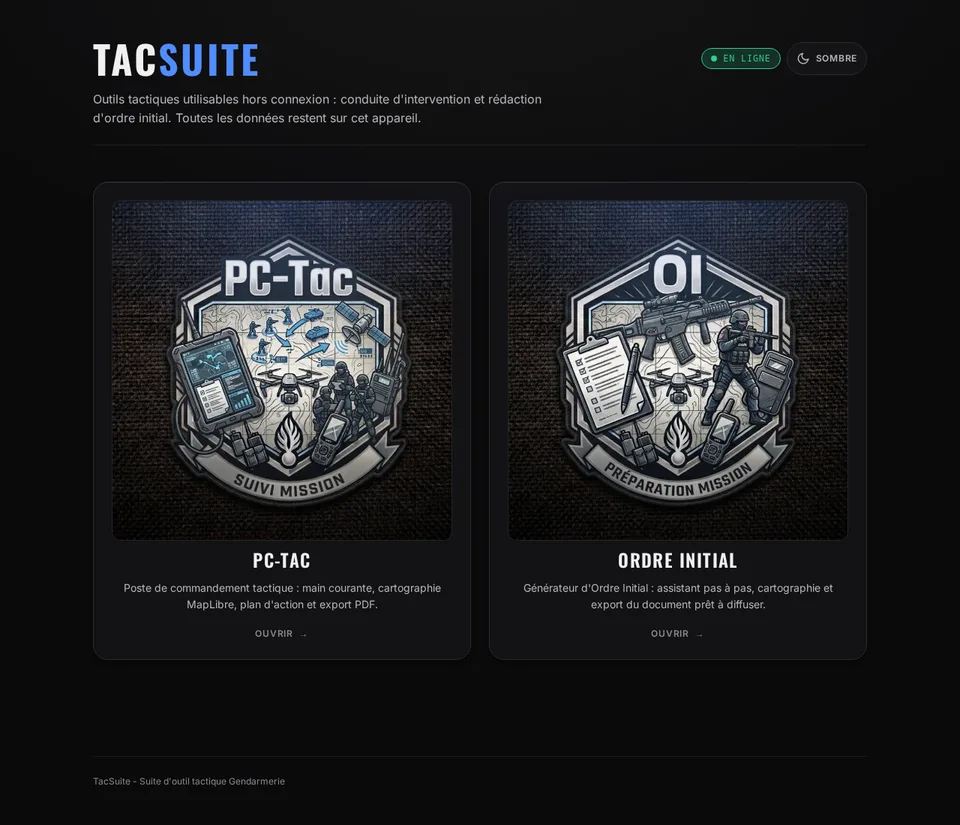

# TacSuite

Outils tactiques qui fonctionnent sans connexion : conduite d'une intervention et rédaction de l'ordre initial.

**Ouvrir TacSuite : https://oxsilaris06.github.io/TacSuite/**



## Les deux applications

**PC-Tac**, poste de commandement tactique :
- main courante horodatée, entrées importantes marquées d'une étoile ;
- fiches des personnes (adversaires, otages, victimes) avec photos annotées ;
- carte : dessin, mesures, carroyage, traces GPX, zones téléchargées pour le hors ligne, suivi d'équipe en temps réel ;
- rapport PDF et synthèse A3, archive `.pctac.zip`.

**Générateur d'OI**, rédaction de l'ordre initial pas à pas :
- huit étapes, de la situation à la finalisation, en version complète ou express ;
- cartographie avec carroyage et captures intégrées au document ;
- PDF prêt à présenter (A4 ou 16:9, clair ou sombre), archive `.oi.zip`.

Un OI exporté s'importe dans PC-Tac.

## Vos données restent sur l'appareil

Pas de compte : ce que vous saisissez reste dans le navigateur de l'appareil utilisé. Pour transmettre un travail, exportez son archive.

Passent par le réseau :
- les fonds de carte ;
- la recherche d'adresse : le texte saisi seulement, jamais des coordonnées ;
- les lignes électriques, seulement si vous affichez leur couche : l'emprise de la zone est alors envoyée à OpenStreetMap (Overpass) et à Enedis ;
- la note de version du portail, lue sur GitHub ;
- si vous l'activez, le suivi d'équipe (Tchap ou relais OsmAnd).

## Hors ligne et sur téléphone

Une première visite en ligne suffit, même du seul portail : PC-Tac et le Générateur d'OI s'ouvrent ensuite sans réseau. Téléchargez à l'avance les zones de carte utiles.

Pour installer TacSuite comme une application : sur Android et sur ordinateur, menu du navigateur puis « Installer » ou « Ajouter à l'écran d'accueil » ; sur iPhone, bouton Partager puis « Sur l'écran d'accueil ».

## Développement

```bash
npm install
npm run dev     # http://localhost:9678
npm run test
npm run build
```

Tests, déploiement et polices des PDF : [docs/DEVELOPPEMENT.md](docs/DEVELOPPEMENT.md).

### Gate de clôture

```bash
~/.ai/bin/gate-tampon npm run check    # typecheck, lint, tests unitaires, PDF des trois fixtures
```

`npm run check` enchaîne `typecheck`, `lint`, `test` et `test:pdf:gate` (génération puis contrôle
structurel des trois fixtures de `tests/pdf/fixtures/`, 18/18 requis) ; il exige `pdfinfo`
(paquet `poppler-utils`) et un `node_modules` installé après le dernier `package-lock.json`.
La copie conforme de la CI, avec les contrôles de prérequis, est `~/.ai/bin/gate-tacsuite`.

### Serveur local

```bash
./scripts/dev.sh          # Vite sur 0.0.0.0:9678, journal dans ~/.cache/tacsuite-serve-dev.log
```

Le lanceur refuse de doubler un serveur déjà sur le port et écrit son PID dans
`~/.cache/tacsuite-dev.pid`. Pour l'arrêter : `kill "$(cat ~/.cache/tacsuite-dev.pid)"` — jamais
`pkill`/`killall` ni `pgrep -f`, qui visent toute la machine.

## Crédits

Cartographie : MapLibre GL. Polices des PDF : Oswald, JetBrains Mono, Noto Sans et Noto Sans Arabic (SIL Open Font License 1.1).
